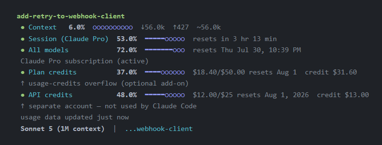

# claude-code-statusline

A [Claude Code](https://claude.com/claude-code) `statusLine` showing context
window usage, your session and weekly rate limits, model, and git branch — plus,
via an optional Chrome-based scraper, the two credit pools Anthropic exposes only
on its web dashboards (the Pro/Max plan's usage-credit overflow, and the
pay-as-you-go Console/API balance).



*Illustrative numbers — not real billing data.*

## Why this exists

The quota rows come straight from the `statusLine` hook payload, which reports
`rate_limits.five_hour` and `rate_limits.seven_day` with reset times as unix
epochs. That is live and exact, and needs no browser.

What the payload does **not** carry is money: neither the plan's usage-credit
overflow nor the separate Console/API credit balance appears anywhere in it.
Those exist only on `claude.ai` and `platform.claude.com`. So the repo has two
independent layers:

1. **Core statusline** (`statusline-command.sh`) — context window, session and
   weekly quota, model, git branch/repo. No extra setup, no browser.
2. **Billing scraper** (`scripts/scrape_claude_usage.py`, optional) — reads the
   two credit figures through a real, non-headless Chrome window over the
   DevTools protocol, on a cron. Headless is not an option: Cloudflare's bot
   challenge blocks it even with valid session cookies.

Layer 2 is inherently more fragile — it scrapes a UI that can change and depends
on a browser you keep open — so it is opt-in and fails visibly rather than
quietly. Credit figures also move on a monthly cadence, so a stale reading there
is far less misleading than a stale session quota would be.

> **Historical note.** This tool originally scraped the quota rows too, because
> the usage page carried a per-model cap (Fable's) that the CLI never exposed.
> That cap has since been retired — the page now shows only "Current session"
> and "All models", the same two buckets the payload already provides — so the
> scrape was removed. If a per-model bucket ever returns to the payload, add it
> with `STATUSLINE_ROWS` (below); no scraping required.

## Install: core statusline

1. Copy `statusline-command.sh` somewhere permanent, e.g. `~/.claude/statusline-command.sh`.
2. Add to `~/.claude/settings.json`:
   ```json
   {
     "statusLine": {
       "type": "command",
       "command": "bash /home/YOU/.claude/statusline-command.sh"
     }
   }
   ```
3. Restart Claude Code (or run `/config` and toggle something to force a reload).

Context, Session, All models, model and branch work immediately. The two credit
rows read "no data" until you set up the scraper, or you can switch them off
entirely — see below.

`rate_limits` is only present for Claude.ai subscribers (Pro/Max) and only after
the first API response in a session, so the quota rows are briefly absent at
startup. They are omitted rather than shown as zero.

## Choosing rows

Set `STATUSLINE_ROWS` to a comma-separated, ordered list. Default:

```
session,weekly,plan_credits,api_credits
```

| Row id | Shows | Source |
|---|---|---|
| `session` | 5-hour rolling limit | payload |
| `weekly` | 7-day limit ("All models") | payload |
| `plan_credits` | Plan usage-credit overflow | scraper |
| `api_credits` | Console/API credit balance | scraper |
| `rl:<key>[=Label]` | Any other `rate_limits` bucket | payload |

Drop both credit rows and the scraper becomes unnecessary — no cron, no Chrome
debug port, no staleness warnings:

```json
{ "statusLine": { "type": "command",
  "command": "STATUSLINE_ROWS=session,weekly bash /home/YOU/.claude/statusline-command.sh" } }
```

The `rl:` form renders any bucket the payload happens to expose, which is the
escape hatch if per-model caps come back:

```
STATUSLINE_ROWS=session,weekly,rl:opus=Opus
```

`CLAUDE_USAGE_CACHE` overrides the cache path, which is handy for testing
against a fixture.

## Install: billing scraper (optional)

Requires Playwright (`pip install playwright && playwright install chromium` —
the package is needed even though this never launches its own browser, only
attaches to yours over CDP) and a Chrome window you keep logged in.

**Built and tested on WSL2 + Windows Chrome.** The debug-port launch commands
are WSL-specific; on native Linux/macOS substitute your own way of starting
Chrome with `--remote-debugging-port=9222` on a logged-in profile. Everything
downstream of "Chrome is up on :9222" is plain Playwright and portable.

1. **Launch Chrome with the debug port and log in.**
   ```bash
   # WSL example — adjust exe/profile paths for your machine
   powershell.exe -NoProfile -Command \
     "Start-Process -FilePath 'C:\Program Files\Google\Chrome\Application\chrome.exe' \
      -ArgumentList '--remote-debugging-port=9222','--profile-directory=Default'"
   ```
   Log into **both** `claude.ai` and `platform.claude.com` — separate logins even
   on the same account.

   Chrome only honours that flag on a **cold** start. Launching it while an
   instance already holds the profile silently forwards to the running process
   and drops the flag, so Chrome must be fully closed first.

2. **Test the scraper once:**
   ```bash
   python3 scripts/scrape_claude_usage.py
   cat ~/.claude/claude-usage-cache.json
   tail ~/.claude/scripts/scrape_claude_usage.log
   ```
   Expect `plan`, `credits`, `console_credits`, per-row `_fetched_at` stamps, and
   a `last_run` block. The log records one line per run (`OK 2 rows`, `FAIL
   no-cdp …`) — the scraper never writes to stdout, so the log is how you find
   out it stopped working.

3. **Cron it** (point at whichever python has Playwright):
   ```
   */5 * * * * /path/to/python3 /path/to/scripts/scrape_claude_usage.py >> ~/.claude/scrape_claude_usage.log 2>&1
   ```
   Hourly is plenty — these are monthly figures.

4. **Optional: `SessionStart` hook.** `scripts/ensure_chrome_debug.sh` launches
   Chrome with the debug flag if Chrome is not running at all. If Chrome **is**
   running without the flag — the common case when it is your daily browser — it
   deliberately does not kill it and prints a one-line reminder instead.
   ```json
   {
     "hooks": {
       "SessionStart": [
         { "hooks": [{ "type": "command", "command": "bash /path/to/scripts/ensure_chrome_debug.sh", "timeout": 8 }] }
       ]
     }
   }
   ```

5. **When it breaks:** `scripts/fix_usage_scrape.sh` does the whole recovery —
   closes Chrome gracefully so tabs restore, relaunches it with the debug port,
   waits for the port, re-scrapes, and verifies the cache actually took new data.
   It prompts before closing anything (`--yes` to skip), and finds a
   Playwright-capable interpreter automatically (override with
   `STATUSLINE_PYTHON`).

   This is a command you run, not a cron job, precisely because recovery means
   closing your browser. Nothing here does that on a timer.

## How staleness is handled

Cached rows carry their own `_fetched_at`. A partial scrape merges over the
previous cache, so without per-row stamps a regex that quietly stops matching
would keep serving its last value forever under a fresh top-level timestamp —
which is exactly how a retired row went unnoticed for weeks. Rows older than the
scrape as a whole are marked individually, and the freshness line names the
failure and the fix:

```
⚠ usage data 2d ago — Chrome not on debug port :9222  fix: bash ~/.claude/scripts/fix_usage_scrape.sh
```

That line only appears when a cached row is actually on screen.

### Caveats

- Anthropic's markup can change and the regexes may need updating. The scraper
  fails closed — it leaves the last good cache alone rather than writing garbage
  — but it now says so in the log and on the statusline.
- Headless scraping does not work. Verified directly: Cloudflare's challenge
  blocks it even with a valid cookie-restored session.
- The scraper never launches or force-quits Chrome. Only `fix_usage_scrape.sh`
  closes it, only when you confirm, and only via a graceful close.
- `used_percentage` and the dollar figures are scraped independently, so they can
  disagree slightly. The "credit" figure is a prepaid balance, **not**
  limit-minus-spent.

## License

MIT — see [LICENSE](LICENSE).
